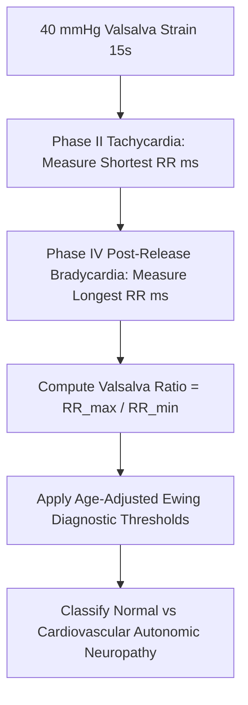

# Cardiac Autonomic Valsalva Ratio Personal Agent Skill

[](LICENSE)
[](https://www.python.org/)
[]()
[]()
[]()

Deterministic, zero-mock personal agent micro-skill for calculating Valsalva Ratio (longest RR in Phase IV / shortest RR in Phase II) to evaluate cardiovagal and adrenergic baroreflex integrity using Ewing diagnostic criteria.

## Architecture



## Quickstart

```python
from client import ValsalvaRatioClient

client = ValsalvaRatioClient()
result = client.evaluate_valsalva_ratio(
    shortest_rr_phase2_ms=520.0,
    longest_rr_phase4_ms=920.0,
    patient_age_years=29
)
print(result)
```

## License

Apache-2.0
